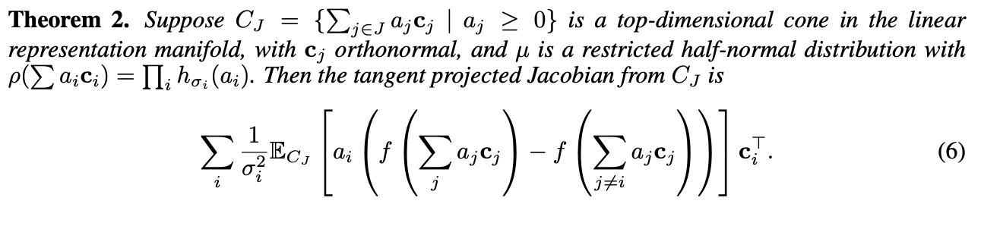
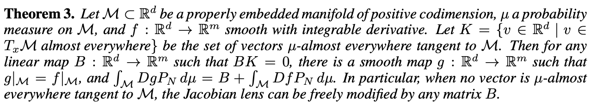
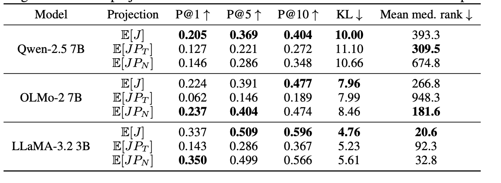

How can we measure curved and linear components in language model activations? And how does that structure affect our ability to interpret what's going on? Our [new preprint](https://github.com/mackeynations/tangent-lenses/blob/main/tangent_paper.pdf) explores these questions by calculating tangent and normal structures in language models. 

## Local tangent structures

The linear representation hypothesis posits that hidden states have this form:
$$ h = \sum_{j \in J \subset I, \ |J| \le k \ll |I|} a_j c_j \qquad a_j > 0, \ c_i \cdot c_j \approx\delta_{ij}.$$
In essence, each atomic concept is linear combined with other, unrelated concepts, in accordance with how important it is to represent a specific object. For example, the token "Einstein" might be decomposed to include concepts like "physics", "genius", and "Germany". However, these concepts can be correlated---in which case, higher order geometry arises. We call this either the weak linear representation hypothesis, or the mixture of manifolds hypothesis. 

Our first idea was that the tangent space is a natural way to split a vector into its linear and nonlinear components, as we show in the Figure:

|  |
|:--:|
|*(a) When the activation space is composed of uncorrelated linear components, the tangent space around each point actually contains the vector pointing to that point, assuming a preferred origin. (b) When linear components are correlated, higher dimensional manifold structures emerge. When this happens, much of the energy of the vector can be captured in the normal projection---it no longer need lie on its own tangent space.*|

As a result, by localizing our representations along their tangent and normal spaces, we can, with qualifications, discombobulate the linear and curved components. We found that quite a bit of the "interpretable" parts we measured were heavily concentrated in the tangent space, i.e. in the "linear" part of the weak linear representation hypothesis. In fact, in Qwen, projecting onto the tangent components is denoising. 

## Decomposing the J-lens

After understanding this local structure, we moved on to studying [the J-lens](https://www.anthropic.com/research/global-workspace), which uses the average Jacobian
$$ E[J] = E\left[\frac{\partial h_{L,t+k}}{\partial h_{\ell, t}}\right] $$
as a first order approximation to the map from layer $\ell$ to layer $L$, averaged across contexts and prediction horizons. The idea of the J-lens is to calculate something like the causal effect of a hidden state on the outputs of the network. (I suspect, but of course cannot prove, that this was also motivated by the desire to adapt the standard logit lens to more exotic residual spaces, such as hyperconnections or attention residual networks---losing the strict identity structure on residual connections makes the logit lens much more poorly adapted to these networks, and the J-lens is the most natural fix.)

Bringing our tangent/normal structure comparison is extremely useful for interpreting these components. The expectation can be rewritten as an integral over the activation manifold, 
$$ E[J] = \int_M \frac{\partial h_{L,t+k}}{\partial h_{\ell, t}} \, d\mu = \int_M \frac{\partial h_{L,t+k}}{\partial h_{\ell, t}} P_T \, d\mu + \int_M \frac{\partial h_{L,t+k}}{\partial h_{\ell, t}} P_N \, d\mu. $$
Analyzing this latter form, we can give explicit characterizations of the tangent projected J-lens, and a serious obstruction to using the normal projected lens. In the case of a stratified manifold as defined by the linear representation hypothesis, we show that the tangent projected lens is precisely a weighted average, for each component *c*, of the average output of the network when *c* is present, minus the average output of the network when *c* is absent but could be included. More formally, 

|  |

On the other hand, the normal-projected component can't be explicitly calculated---in fact, up to some mild hypotheses, there are smooth functions which are identical to the language model when applied on-manifold, but are arbitrarily different on the normal bundle! Formally,

|  |

This is potentially extremely concerning, if the J-lens is used as an auditing tool for models produced by untrusted actors---either during recursive self-improvement or otherwise. 

This also suggests a natural solution, however---the tangent projected J-lens has a very nice explicit form, and can be directly calculated, though at greater expense than the full J-lens. Unfortunately, we found that this trades off very poorly for lens performance. Large amounts of cancellation seem to occur in the tangent projected lens, and different tasks have extremely different performance on the tangent and normal projected lenses. 

|  |

In our experiments, the normal projection could not be ablated away without substantial performance losses in the J-lens---which we found quite surprising, in the light of our earlier results on the tangent-normal split! Some form of cancellation in the tangent lens is likely the culprit---but why the extension of the language model to off-manifold values repairs this not something we can fully account for! 

If you're interested in a more detailed description of our study, including all the experiment details, proofs, and an analysis written well before my bedtime (mostly), please do check out [our paper](https://github.com/mackeynations/tangent-lenses/blob/main/tangent_paper.pdf)! 
